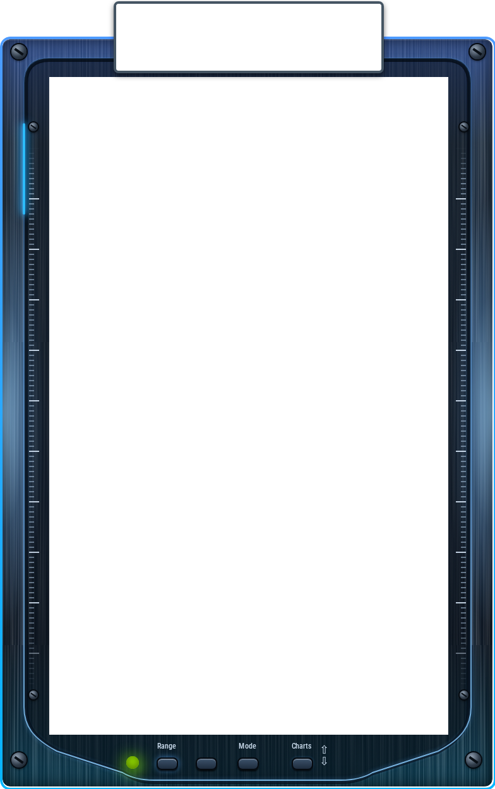

# stream-navi-overlay

Overlay Twitch/OBS pour le streaming de simulateur de vol, affichant le logo de la compagnie aerienne en cours de vol.



## Fonctionnement

- **Support physique** : boitier metallique avec cadre degrade bleu/cyan, cadrans, vis et LED d'ambiance, entierement rendu en CSS/SVG.
- **Bandeau compagnie** : affiche automatiquement le logo de la compagnie aerienne du dernier plan de vol.
- **Detection automatique** via [SimBrief](https://www.simbrief.com) : l'overlay interroge l'API toutes les 30 secondes et lit le code ICAO compagnie (`general.icao_airline`).
- **Mode manuel** (`?cie=AFR` ou `#AFR` dans l'URL) : force une compagnie pour les tests, sans dependre de SimBrief.

## Stack technique

- [Vue 3](https://vuejs.org) (Composition API, `<script setup>`)
- [Bun](https://bun.sh) comme gestionnaire de paquets et runtime de script
- [Vite](https://vite.dev) pour le dev server et le build
- SCSS (Dart Sass) pour les styles
- [vite-plugin-singlefile](https://github.com/richardtallent/vite-plugin-singlefile) : le build produit un **unique `dist/index.html` autonome** (JS/CSS inlines), indispensable pour une source navigateur OBS en "Fichier local" (`file://`)

## Demarrage

```bash
bun install
bun run dev      # serveur de developpement avec rechargement a chaud
```

## Build pour OBS

```bash
bun run build     # genere dist/index.html (autonome)
```

Dans OBS : **Sources > + > Source navigateur**, cocher **Fichier local**, pointer sur `dist/index.html`, largeur `392`, hauteur `625` (a multiplier par la variable `--scale` si elle est modifiee dans `scss/_variables.scss`).

## Configuration SimBrief

Definir l'identifiant SimBrief de l'une des trois facons suivantes (par ordre de priorite) :

1. **Parametre URL** : `dist/index.html?simbrief=monpseudo` — ideal pour tester
2. **Variable de build** : `VITE_SIMBRIEF_USERNAME=monpseudo` dans `.env.local` — embarquee au build
3. **Parametre numerique** : `?simbrief=123456` accepte aussi le Pilot ID SimBrief

> Les variables `VITE_*` sont integrees en clair dans le build. Ne pas y mettre de mot de passe ni de cle secrete.

L'API SimBrief est appellée directement depuis le navigateur ; le mode SimBrief depend donc de l'autorisation CORS renvoyee par SimBrief. Si elle bloque, l'overlay conserve le logo courant et emet un avertissement dans la console.

## Mode manuel

Ajouter `?cie=CODE` ou `#CODE` a l'URL desactive SimBrief pour la session :

```
file:///C:/overlay-navi/dist/index.html?cie=AFR
file:///C:/overlay-navi/dist/index.html#EZY
```

L'API `window.overlay` reste accessible depuis la console de la source navigateur OBS :

```js
overlay.compagnie('KLM')   // change la compagnie a chaud
overlay.liste()             // renvoie tous les codes disponibles
```

## Structure du projet

```
index.html                  point d'entree Vite
src/
  main.js                   bootstrap Vue + import SCSS global
  App.vue                   template du support (HTML/SVG)
  composables/
    useOverlay.js            logique metier : donnees compagnies, SimBrief, mode manuel
scss/
  overlay.scss               assemble les partials via @use
  _variables.scss             custom properties CSS (couleurs, echelle)
  _reset.scss                 reset html/body
  _screen.scss                conteneur .overlay
  _frame.scss                 cadre metallique CSS
  _badge.scss                 bandeau logo compagnie
  _light.scss                 LED verte
  _animations.scss            animations CSS (power-on, groove runner, LED pulse...)
public/
  logos/                     logos des compagnies (PNG/SVG, copies tels quels dans dist/)
scripts/
  screenshot.mjs              capture Playwright du rendu
docs/
  preview.png                 capture utilisee dans ce README
```

## Compagnies et logos

La liste des compagnies se configure dans `src/composables/useOverlay.js` (objet `COMPAGNIES`), avec le prefixe ICAO du callsign comme cle :

```js
const COMPAGNIES = {
  AFR: { nom: 'Air France', logo: 'air-france.svg' },
  EZY: { nom: 'easyJet',   logo: 'easyjet.svg' },
  // ...
}
```

Chaque logo doit exister dans `public/logos/` (PNG ou SVG, fond transparent). Si le fichier est absent ou que le code ne correspond a aucune compagnie, le bandeau reste vide.

## Screenshot automatique (CI)

Le fichier `docs/preview.png` est regenere automatiquement par le workflow [`.github/workflows/screenshot.yml`](.github/workflows/screenshot.yml) a chaque push sur `main`.

Pour le generer en local :

```bash
bun run build
bun run screenshot   # ecrit docs/preview.png
```

> Le workflow a besoin des permissions d'ecriture du `GITHUB_TOKEN` : verifier **Settings > Actions > General > Workflow permissions > Read and write permissions** sur le depot.
